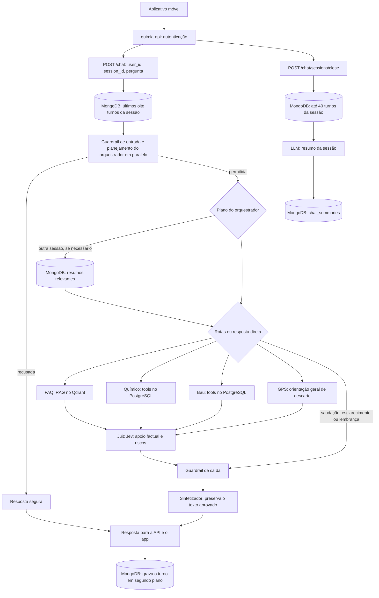

<div align="center">

# Quimia Agent (Kemi)

**Motor de IA da Kemi: agentes especializados, RAG, avaliação factual, guardrails e observabilidade.**

[](https://github.com/Quimia-br/quimia-agent/actions/workflows/ci.yml)
[](https://www.python.org/)
[](https://fastapi.tiangolo.com/)
[](https://www.langchain.com/langgraph)
[](https://www.mongodb.com/)

[Visão geral](#visão-geral) · [Arquitetura](#arquitetura-de-alto-nível) · [Requisitos de IA](#requisitos-de-ia-atendidos) · [Como rodar](#como-rodar) · [Variáveis](#variáveis-de-ambiente) · [Rotas](#rotas) · [Bancos](#bancos-de-dados) · [Testes e CI](#testes-e-ci) · [Deploy](#deploy)

</div>

Backend FastAPI do assistente Kemi no aplicativo móvel Quimia. O app conversa com o `quimia-api`, que encaminha as perguntas ao `quimia-agent`. O serviço usa LangChain para os agentes, LangGraph para o fluxo, PostgreSQL para catálogo e dados pessoais, MongoDB para conversas, Qdrant para o FAQ e LangSmith para métricas operacionais.

## Visão geral

| Tema | Implementação |
| --- | --- |
| Agentes | Orquestrador, especialistas Baú, FAQ, GPS e Químico, juiz, guardrails, sintetizador e sumarizador de sessões. |
| Orquestração | Grafo LangGraph em `app/agent/workflow.py`, com até três rotas por pergunta. |
| Sessões e memória | Últimos oito turnos da sessão e resumos de sessões encerradas no MongoDB. |
| Apoio factual | Tools PostgreSQL, RAG do FAQ no Qdrant e avaliação das evidências pelo juiz Jev. |
| Observabilidade | Traces no LangSmith e painel com latência, erros, custos estimados e feedback de resolução. |

### O que o serviço faz

- Responde sobre produtos de limpeza, composição, incompatibilidades e cuidados com base nas informações disponíveis no banco.
- Consulta Estante, Cômodos, histórico de misturas e recomendações do usuário.
- Responde dúvidas sobre as funcionalidades do Quimia usando o FAQ oficial indexado no Qdrant.
- Orienta sobre descarte de forma genérica e direciona à funcionalidade **Proximidade**. Não confirma pontos de coleta específicos no chat.
- Lê fotos de rótulos e devolve candidatos de produto para a API conferir no catálogo.
- Mantém os últimos oito turnos da sessão como contexto e pode buscar resumos relevantes de sessões encerradas do mesmo usuário.

## Arquitetura de alto nível



[Visualizar a arquitetura no Figma](https://www.figma.com/board/N8yPjMk4pmIEqGV1sUh4kg/Fluxogramas?node-id=459-1281&t=3wGkhvAyBm820483-0)

O histórico do MongoDB é carregado antes do grafo. O guardrail de entrada e o planejamento rodam em paralelo, mas nenhum especialista ou tool consulta dados antes da autorização do guardrail. O orquestrador escolhe até três rotas e pode indicar que a pergunta depende de outra sessão. Rotas independentes dos especialistas podem rodar em paralelo; uma rota dependente recebe o resultado da anterior.

O **Químico** e o **Baú** usam tools antes de produzir uma resposta estruturada. O **FAQ** recupera evidências do documento oficial antes de responder. A rota **GPS** usa atualmente uma orientação fixa e conservadora no fluxo, sem buscar pontos de coleta. O Jev avalia separadamente as respostas dos especialistas e suas evidências; respostas reprovadas não são entregues como fatos confirmados. Depois, o guardrail de saída verifica a resposta, e o sintetizador entrega o texto aprovado sem reescrevê-lo. Saudações, respostas sem especialista e pedidos apenas de memória passam pelo guardrail de saída, mas não pela etapa Jev dos especialistas. O encerramento da sessão é uma chamada separada, não automática.

## Requisitos de IA atendidos

| Requisito | Onde está no projeto |
| --- | --- |
| Múltiplos agentes | Orquestrador, quatro especialistas, juiz, guardrails e sumarizador em `app/agent/` e `app/memory/`. |
| LangChain para os agentes | `app/agent/base.py`, `app/agent/specialists/tool_agent.py` e especialistas. |
| LangGraph para orquestração | `app/agent/workflow.py`. |
| Sessões por usuário | `app/routes/chat_routes.py`, `app/memory/chat_history.py` e contratos em `app/schemas/schemas.py`. |
| Memória de longo prazo | `app/memory/summarizer.py`, `chat_summaries.py` e busca seletiva em `tools.py`. |
| RAG com fonte oficial | PDF em `data/` recuperado pelo especialista FAQ via embeddings e Qdrant. |
| Juiz contra alucinações | `app/agent/judge.py` e `app/agent/jev.py`; confronta resposta e evidências. |
| Guardrails | `app/agent/guardrails/input_guardrail.py` e `output_guardrail.py`. |
| Observabilidade e SRE | `app/observability/`, LangSmith e painel em `/monitor.html`. |
| MCP e A2A | Não são usados: a comunicação entre especialistas ocorre no mesmo grafo, sem agentes externos. |

## Stack

Python 3.12 no CI, FastAPI, LangChain, LangGraph, Pydantic, MongoDB, PostgreSQL, Qdrant, LangSmith, modelos via CommandCode, Gemini para embeddings e pytest.

## Padrão de projeto

O padrão mais claro é um **pipeline de processamento**, implementado como grafo em `app/agent/workflow.py`: entrada → roteamento → especialistas → juiz → guardrail de saída → entrega. O grafo também contém desvios condicionais, como recusa na entrada, busca de memória e resposta sem especialista; portanto, não é uma cadeia linear obrigatória.

A seleção dos especialistas segue a ideia de **Strategy**: Baú, FAQ, GPS e Químico atendem intenções diferentes sob contratos de resposta comuns (`app/agent/contracts.py`). A função `specialist_factory` em `app/agent/workflow.py` instancia a implementação escolhida para cada rota. Essa é uma fábrica simples, não uma implementação formal do padrão GoF *Factory Method*. O orquestrador decide quais rotas executar e pode combinar especialistas na mesma pergunta.

### Estrutura de diretórios

```text
app/
├── agent/
│   ├── base.py                 # Base LangChain e saída Pydantic
│   ├── contracts.py            # Contratos entre as etapas
│   ├── workflow.py             # Grafo LangGraph
│   ├── orchestrator.py         # Roteamento e decisão de buscar memória
│   ├── prompts.py              # Instruções dos agentes
│   ├── llms.py                 # Modelo principal e fallback
│   ├── jev.py, judge.py        # Avaliação factual e de segurança
│   ├── guardrails/             # Guardrails de entrada e saída
│   ├── specialists/            # Químico, Baú, FAQ, GPS e tools
│   └── rotulo.py               # Leitura e conferência de rótulos
├── memory/
│   ├── chat_history.py         # Contexto da sessão atual
│   ├── chat_summaries.py       # Leitura e gravação de resumos
│   ├── summarizer.py           # Resumo ao encerrar uma sessão
│   └── tools.py                # Busca seletiva entre sessões
├── database/                   # Conexões PostgreSQL e MongoDB
├── routes/                     # Chat, saúde, monitor e busca por imagem
├── schemas/                    # Contratos HTTP
├── observability/              # Traces, custos, métricas e painel
├── core/config.py              # Variáveis de ambiente e validação
└── main.py                     # Aplicação FastAPI
data/                           # PDF oficial do FAQ
scripts/                        # Diagnóstico e empacotamento para deploy
tests/                          # Testes automatizados
.github/workflows/              # CI e deploy por Release
```

## Como rodar

O CI usa **Python 3.12**. Execute os comandos na raiz do repositório, em PowerShell. O projeto não exige criação de ambiente virtual.

```powershell
python -m pip install -r requirements-dev.txt
if (-not (Test-Path .env)) { Copy-Item .env.example .env }
```

Preencha o `.env` com os endereços e as chaves reais dos serviços. O arquivo é ignorado pelo Git. `requirements-dev.txt` inclui as dependências de produção e pytest; para uma instalação apenas de produção, use `requirements.txt`.

O FAQ precisa ser indexado ao menos uma vez no Qdrant configurado:

```powershell
python -m app.agent.specialists.faq.ingest
python -m uvicorn app.main:app --reload
```

A aplicação local fica em `http://127.0.0.1:8000`; o Swagger fica em `/docs`. Na inicialização, a aplicação valida as variáveis obrigatórias e a presença do PDF. Por padrão tenta aquecer conexões com os serviços em segundo plano; `AGENT_WARMUP=0` desliga esse aquecimento.

## Variáveis de ambiente

Use [`.env.example`](.env.example) como referência. As variáveis abaixo são exigidas na inicialização:

| Variável | Uso |
| --- | --- |
| `COMMANDCODE_API_KEY` | Modelos de chat e juiz Jev pela Provider API. |
| `GEMINI_API_KEY` | Embeddings do FAQ. |
| `DATABASE_URL` | PostgreSQL com catálogo, FDS e dados pessoais. |
| `MONGODB_URI` | Histórico e resumos das conversas. |
| `QDRANT_URL` | Índice vetorial do FAQ. |

Configurações adicionais usadas pelo código:

| Variável | Padrão ou finalidade |
| --- | --- |
| `MONGODB_DB` | `quimia`; use outro banco ao testar sem querer gravar dados reais. |
| `QDRANT_API_KEY` | Chave do Qdrant quando o cluster exigir autenticação. |
| `QDRANT_FAQ_COLLECTION` | `quimia_faq_chunks`. |
| `GEMINI_EMBEDDING_MODEL` / `EMBEDDING_DIMENSION` | `gemini-embedding-2` / `768`; devem ser compatíveis com a collection. |
| `FAQ_TOP_K` / `FAQ_SCORE_THRESHOLD` | `6` / `0.45`. |
| `COMMANDCODE_BASE_URL` | `https://api.commandcode.ai/provider/v1`; a raiz `https://api.commandcode.ai/` é normalizada para essa rota. |
| `COMMANDCODE_MODEL` / `COMMANDCODE_MODEL_FALLBACK` | `z-ai/glm-5.3-flash` / `minimax/minimax-m3.1-flash`. |
| `COMMANDCODE_TIMEOUT_SECONDS` / `COMMANDCODE_MAX_RETRIES` | `20` / `1`. |
| `COMMANDCODE_REASONING_EFFORT` | `low`; valor vazio omite o parâmetro. |
| `CHAT_BUDGET_SECONDS` / `ROTULO_BUDGET_SECONDS` | `25` / `22`; ao exceder, a rota responde 504 em JSON. |
| `CORS_ORIGINS` | `http://localhost:3000,http://localhost:8081`; origens separadas por vírgula. `*` é rejeitado com credenciais habilitadas. |
| `AGENT_THREADS` / `AGENT_WARMUP` | `64` threads / `1` para aquecimento na inicialização. |
| `QUIMIA_AGENTE_TOKEN` | Segredo compartilhado com o `quimia-api`; quando definido, protege as três rotas POST de serviço. |

O juiz usa `typesafe/jev-1.14.0` via `/systemone`, com `COMMANDCODE_API_KEY`. O FAQ usa Gemini apenas para embeddings. O modelo principal e o fallback também são usados na leitura de rótulos como leituras independentes.

## Bancos de dados

| Serviço | Uso no agente | Código |
| --- | --- | --- |
| MongoDB | Turnos por `user_id` e `session_id` e resumos de sessões encerradas. | `app/database/mongo.py` e `app/memory/`. |
| PostgreSQL | Catálogo, FDS, dados pessoais e históricos consultados pelas tools parametrizadas. | `app/database/postgres.py` e `app/agent/specialists/`. |
| Qdrant | Trechos vetorizados do PDF oficial do FAQ; a pergunta é transformada em embedding antes da busca. | `app/agent/specialists/faq/`. |

## Rotas

| Método e rota | Função |
| --- | --- |
| `GET /` | Confirma que a aplicação iniciou; não testa bancos. |
| `GET /health/` | Testa PostgreSQL (`SELECT 1`) e MongoDB (`ping`); retorna 503 se algum estiver indisponível. |
| `POST /chat` | Processa uma pergunta e devolve a resposta e os agentes acionados. |
| `POST /chat/sessions/close` | Resume e grava uma sessão encerrada. |
| `POST /produtos/busca-por-imagem` | Recebe uma foto no campo multipart `imagem` e devolve candidatos lidos. |
| `GET /monitor.html` | Página do painel operacional. |
| `GET /monitor` | Dados do painel; restrito a conexões loopback. |
| `POST /monitor/feedback/{trace_id}` | Registra se uma resposta resolveu o pedido; restrito a loopback. |

### Conversa

`POST /chat` recebe um UUID de usuário, um identificador de sessão de 1 a 128 caracteres e uma pergunta de 1 a 4.000 caracteres. Exemplo:

```json
{
  "user_id": "00000000-0000-0000-0000-000000000001",
  "session_id": "sessao-1",
  "pergunta": "Como funciona a Estante?"
}
```

Resposta:

```json
{
  "resposta": "Texto aprovado para o usuário.",
  "agentes_acionados": ["guardrail_entrada", "orquestrador", "faq", "juiz", "guardrail_saida", "sintetizador"]
}
```

`agentes_acionados` descreve as etapas efetivamente executadas; a lista muda conforme o roteamento. Validação de corpo retorna 422; falha de processamento, 503; limite de tempo, 504. `POST /chat` e o fechamento de sessão incluem o header `X-Trace-Id` quando a requisição é observada.

Com `QUIMIA_AGENTE_TOKEN` configurado, as rotas POST de chat, encerramento e imagem exigem `Authorization: Bearer <segredo>`. Esse token identifica o serviço chamador; o agente não valida por conta própria se o `user_id` do corpo pertence ao usuário final. Essa verificação cabe ao `quimia-api`, que obtém o UUID do JWT. Sem o token configurado, as rotas permanecem abertas para testes locais pelo Swagger. CORS restringe origens de navegadores, mas não autentica chamadas HTTP.

### Encerramento de sessão

`POST /chat/sessions/close` recebe `user_id` e `session_id`:

```json
{
  "user_id": "00000000-0000-0000-0000-000000000001",
  "session_id": "sessao-1"
}
```

Devolve `{"session_id":"sessao-1","status":"resumida"}`. `status` também pode ser `ja_resumida` quando já existe resumo, ou `sem_turnos` quando não há mensagens salvas. Repetir o fechamento não sobrescreve o resumo. Uma falha de processamento retorna 503.

### Busca de produto por imagem

`POST /produtos/busca-por-imagem` aceita JPEG, PNG ou WebP de até **5 MB** no campo `imagem`. O serviço valida os primeiros bytes, não apenas o `Content-Type` declarado. Exemplo em PowerShell:

```powershell
curl.exe -F "imagem=@C:\caminho\rotulo.jpg" http://127.0.0.1:8000/produtos/busca-por-imagem
```

Resposta: `{"candidatos":[{"nome":"...","marca":"...","cod_barras":"..."}]}`. A lista pode ser vazia quando não há leitura confiável. Dois modelos leem a imagem em paralelo; o serviço aceita o que ambos reconhecerem, confere o dígito de códigos GTIN válidos e tenta associar o resultado ao catálogo por código ou nome sem ambiguidade. Com apenas uma leitura disponível, somente candidatos com código válido são aceitos. A API chamadora decide como usar os candidatos. A foto não é gravada no banco. Imagem vazia, grande ou de tipo não aceito retorna 400, 413 ou 415; falha de leitura retorna 503 ou 504.

## Tools dos especialistas

| Especialista | Fonte e comportamento |
| --- | --- |
| Químico | PostgreSQL: produtos, FDS ativas, incompatibilidades, regras entre substâncias e primeiros socorros. |
| Baú | PostgreSQL: Estante, Cômodos, histórico pessoal de misturas e recomendações, filtrados pelo usuário. |
| FAQ | PDF oficial indexado no Qdrant; responde apenas com apoio nos trechos recuperados. |
| GPS | Orientação fixa e conservadora para descarte; remete à Proximidade. Não consulta pontos específicos. |

As tools do Químico estão em `app/agent/specialists/quimico/quimico_tools.py`: `buscar_produto`, `consultar_composicao_produto`, `verificar_compatibilidade_produtos`, `consultar_incompatibilidades_produto`, `consultar_primeiros_socorros`, `consultar_regra_entre_substancias` e `orientacao_geral_de_emergencia`. A verificação de dois produtos usa `fn_match_produtos`. Um retorno `compativel` que só representa ausência de regra é tratado pelo agente como `nao_avaliado`: ausência de incompatibilidade cadastrada não comprova segurança.

As tools do Baú estão em `app/agent/specialists/bau/bau_tools.py`: `listar_estantes_usuario`, `listar_produtos_estante`, `listar_produtos_por_comodo`, `consultar_historico_misturas` e `consultar_historico_recomendacoes`. Os filtros temporais dos históricos usam início inclusivo e fim exclusivo. As consultas dos especialistas são somente leitura, parametrizadas, com limite de linhas e timeout de instrução SQL de 5 segundos. Químico e Baú podem fazer até seis rodadas de tools por pergunta.

### FAQ com RAG e Qdrant

A fonte é `data/quimia_instrucao_normativa_faq_funcionalidades_v1.0.pdf`. A ingestão divide o PDF em trechos de 700 caracteres com sobreposição de 150, gera embeddings de 768 dimensões e substitui o conteúdo da collection configurada no Qdrant. Reexecute `python -m app.agent.specialists.faq.ingest` quando o PDF mudar. Na pergunta, o retriever busca até `FAQ_TOP_K` trechos acima do limiar configurado. Sem evidência suficiente, a resposta é “Não encontrei essa informação no FAQ oficial do Quimia”.

Quando há memória de outra sessão, o FAQ pode receber o resumo para entender referências do usuário. **A recuperação dos trechos do FAQ ainda usa somente a pergunta original**; uma referência vaga como “aquela função de ontem” pode, portanto, não recuperar o trecho correto. O histórico não comprova regras ou funcionalidades do aplicativo.

## Memória das conversas

`app/memory/` concentra o histórico da sessão atual, os resumos e a tool de busca:

1. Depois de uma resposta concluída, `chat_turns` recebe `user_id`, `session_id`, pergunta, resposta e data UTC. A gravação ocorre em segundo plano. Uma resposta que falhou não vira turno; se a gravação falhar, a resposta já pode ter sido entregue.
2. Antes de cada resposta, o serviço carrega os **oito turnos mais recentes** do mesmo usuário e da mesma sessão, em ordem cronológica. No contexto, pergunta e resposta são limitadas a 1.000 e 2.000 caracteres.
3. Ao encerrar a sessão, o modelo resume até **40 turnos mais recentes** em até 1.200 caracteres e grava o resultado em `chat_summaries`. O resumo é salvo uma vez por par `user_id` e `session_id`.
4. Quando o orquestrador indica `buscar_memoria`, a tool consulta até **100 resumos mais recentes de outras sessões** do mesmo usuário. Ela ordena pela sobreposição de palavras com a pergunta, sem diferenciar acentos, e devolve até **três** resumos. Para “ontem”, filtra pela data de criação do resumo no fuso `America/Sao_Paulo`.

A busca é lexical, não semântica: uma pergunta sem palavras em comum com o resumo pode não encontrá-lo. “Ontem” usa a data em que o **resumo foi gravado**, que pode ser diferente da data em que cada mensagem foi enviada. Sessões ainda abertas não possuem resumo para a busca entre sessões. Quando a pergunta pede apenas uma lembrança, o fluxo apresenta o primeiro resumo encontrado; quando também pede análise, os resumos selecionados seguem como contexto do especialista. Relatos guardados na memória não comprovam composição, segurança ou aceitação de resíduos.

## Observabilidade e SRE

O painel fica em `http://127.0.0.1:8000/monitor.html`. A página e os arquivos estáticos são públicos, mas `GET /monitor` e `POST /monitor/feedback/{trace_id}` só aceitam conexões loopback. O painel consulta as métricas periodicamente; um proxy que apresente conexões como loopback precisa restringir essas rotas na publicação.

Com `LANGSMITH_TRACING=true` e `LANGSMITH_API_KEY`, a aplicação exporta traces operacionais para o projeto `LANGSMITH_PROJECT` (padrão `quimia-agent`). São registrados tempos, etapas, modelos, tools, falhas e uso de tokens disponível, **sem enviar perguntas, respostas, prompts, evidências, `user_id` ou `session_id`**. O tracing automático de conteúdo é desabilitado nas rotas de chat e fechamento. Não há armazenamento local alternativo para essas métricas; sem LangSmith configurado ou disponível, a consulta ao painel retorna 503. A leitura usa cache em memória de 30 segundos.

O painel calcula latência média, p50/p95/p99, índice de erros, uso de modelos, fallback, custos conhecidos e chamadas sem custo aferível. `SRE_LATENCY_P95_MS` (padrão `8000`) e `SRE_ERROR_RATE_LIMIT` (padrão `0.05`) são metas operacionais, não garantias. Preços de referência estão em `app/observability/pricing.json`; `SRE_PRICING_JSON` permite substituí-los. Os valores são estimativas por tabela, não a fatura. O painel projeta cenários semanais de 100 e 1.000 usuários e permite registrar manualmente se um turno elegível resolveu o pedido; não presume que HTTP 200 signifique resolução. O feedback é guardado no LangSmith.

## Testes e CI

```powershell
python -m pytest -q
python -m pytest -q --cov=app --cov-report=term-missing --cov-fail-under=80
python scripts/cenarios_http.py --sem-ia
```

O último comando verifica contratos HTTP locais sem chamar modelos de IA; ele ainda consulta `/health/` e o MongoDB no fechamento de uma sessão inexistente. Para testar o fluxo completo via HTTP, retire `--sem-ia` e use um banco MongoDB de teste. Chamadas reais a modelos e embeddings podem gerar custo.

O workflow [`ci.yml`](.github/workflows/ci.yml) usa Python 3.12 e valida instalação, importação, testes, cobertura mínima de 80% e o ZIP de deploy. Pull requests e pushes para `main` executam os checks. O título da PR é validado por [`pr-title.yml`](.github/workflows/pr-title.yml) no formato Conventional Commits.

## Deploy

O deploy usa Discloud e a configuração em `discloud.config`. Uma **Release publicada** envia o ZIP à Discloud e faz um smoke check em `GET /`. O pacote contém `app/`, `data/`, `requirements.txt` e `discloud.config`; não inclui `.env`. Configure os segredos e demais variáveis no ambiente da hospedagem. O helper de deploy usa `DISCLOUD_TOKEN` e `DISCLOUD_APP_ID` nos secrets do workflow para atualizar a aplicação existente. O arquivo `discloud.config` inicia o Uvicorn na porta 8080.

## Integração com o quimia-api e o aplicativo móvel

O aplicativo envia mensagens ao `quimia-api`, que autentica o usuário e encaminha as chamadas ao `quimia-agent`. O contrato de `/chat`, `/chat/sessions/close` e `/produtos/busca-por-imagem` corresponde ao cliente HTTP do `quimia-api`.

Configure o mesmo segredo nos dois serviços e a URL base do agente na API:

```text
quimia-agent: QUIMIA_AGENTE_TOKEN=<segredo-compartilhado>
quimia-api:   QUIMIA_AGENTE_TOKEN=<mesmo-segredo>
quimia-api:   QUIMIA_AGENTE_URL=<URL-base-do-quimia-agent>
```

`QUIMIA_AGENTE_URL` aponta para a raiz do serviço, por exemplo `http://localhost:8000` se os dois processos rodam na mesma máquina. Não acrescente `/chat`. Quando o token está configurado no agente, ele é exigido como `Authorization: Bearer <segredo>` nas três rotas POST citadas. `GET /health/` e `/docs` permanecem sem essa exigência. Configure o segredo antes de expor o serviço; sem `QUIMIA_AGENTE_URL`, o chat da API fica indisponível.

No aplicativo, envie o JWT do usuário ao `POST /api/v1/chat/mensagens` com `{"texto":"Sua pergunta"}`. A resposta inclui `texto` e `sessaoId`; envie `sessaoId` nas mensagens seguintes para continuar a mesma conversa. Para iniciar um novo chat, use `POST /api/v1/chat/sessoes/{sessaoId}/encerrar` e depois envie uma mensagem sem `sessaoId`.

## Limites atuais

- O token autentica o serviço chamador, mas a associação entre `user_id` e o usuário final depende do `quimia-api`. Não exponha as rotas de serviço diretamente ao aplicativo.
- A memória entre sessões depende do fechamento da sessão, dos últimos 40 turnos resumidos e da correspondência lexical entre pergunta e resumo.
- O FAQ não reformula a consulta ao Qdrant com o contexto recuperado de outras sessões.
- O GPS não consulta nem confirma endereços, horários ou aceitação em pontos de descarte; a orientação é usar Proximidade e confirmar com o ponto responsável.
- `GET /` e o smoke check de deploy confirmam que a aplicação respondeu; use `GET /health/` para verificar PostgreSQL e MongoDB.
